# Surrogate Modelling Projects

Six end-to-end projects on **surrogate modelling**: replacing an expensive simulator or experiment with a fast machine learning model that is accurate, honest about its uncertainty and safe to optimise against. Three projects use real data (laboratory tests, CMIP6 climate-model output, field sensors, an outbreak record) and three build and verify their own physics simulator first.

| # | Project | Model | Headline result |
|---|---|---|---|
| 1 | [Designing a heat sink](01-designing-a-heat-sink/) | Multi-fidelity Gaussian process + constrained Bayesian optimisation | **0.23%** test error from 60 runs; verified 126 g design in 40 runs vs 140 g for random search after 400 |
| 2 | [Designing low-carbon concrete](02-low-carbon-concrete/) | Monotonic gradient boosting, GP, split-conformal bounds | Test R² **0.90**; credible mixes with **8–13% less CO₂** |
| 3 | [Emulating a climate model](03-emulating-a-climate-model/) | Multi-output GP, ridge, random forest, MLP, pattern scaling | Within **0.05–0.07 K** of the noise floor on a held-out scenario |
| 4 | [Physics-informed neural networks](04-physics-informed-neural-networks/) | PINN in PyTorch vs finite differences | PINN **3×** better than a data-only network on a held-out sensor |
| 5 | [Fourier neural operator](05-neural-operators/) | FNO from scratch in PyTorch | **0.44%** test error, zero-shot super-resolution, **~170×** faster than the solver |
| 6 | [Calibrating an epidemic model](06-calibrating-an-epidemic-model/) | GP emulators, history matching, synthetic likelihood | Same posterior as brute-force ABC with **35× fewer** simulator runs |

**Tools:** Python · NumPy · SciPy · scikit-learn · PyTorch · pandas · xarray / netCDF4 · Matplotlib

**Methods across the projects:** design of experiments (Latin hypercubes, Sobol' sequences), Gaussian processes, multi-fidelity learning, Bayesian optimisation, Sobol' sensitivity analysis, conformal prediction, PCA/EOF dimension reduction, physics-informed losses, neural operators, history matching and Bayesian calibration.

---

## 1. Designing a heat sink with a surrogate model

Find the lightest aluminium plate-fin heat sink that keeps a 100 W processor below 85 °C, with a real fan curve.

<table><tr>
<td>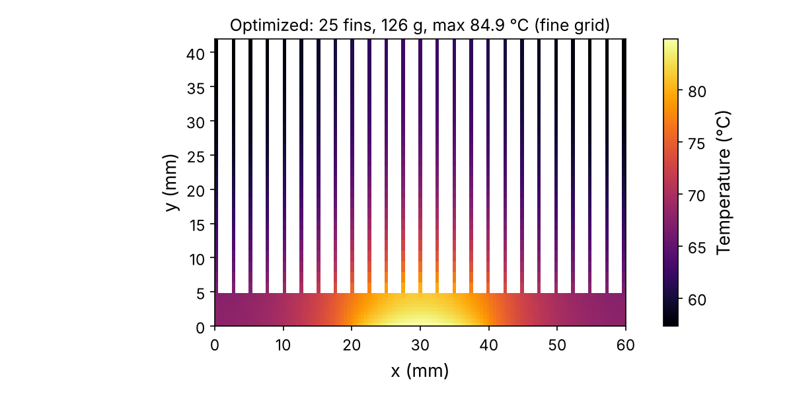</td>
<td>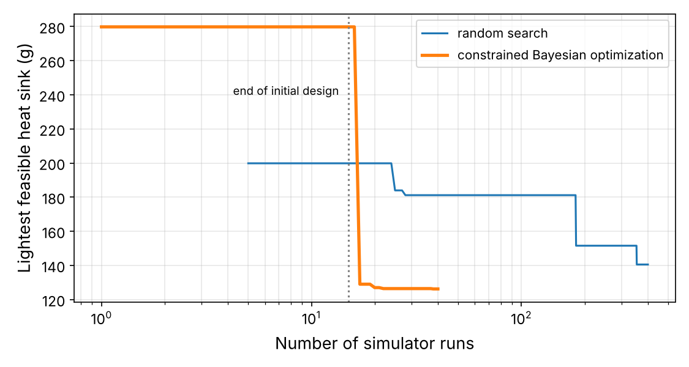</td>
</tr></table>

- Built a **3D finite-volume heat-conduction simulator** (vectorised NumPy, SciPy sparse) with fin-convection and fan/duct correlations, verified against 1D fin theory (within 1.4%) and a grid-convergence study.
- Physics-based features, including the cheap 1D fin theory, cut the GP's cross-validation error from **10.4% to 0.36%**; final test error **0.23%** with calibrated 95% intervals.
- Multi-fidelity learning: with only 10 expensive runs, the physics-informed models beat a plain GP trained on 60.
- **Constrained Bayesian optimisation** finds a verified 126 g design in 40 runs; random search reaches only 140 g after 400.
- A "1D theory + 30% margin" design looks fine at 81 g but runs **14 °C too hot**: optimisers exploit model error. Finished with Sobol' indices, a verified Pareto front and a surrogate that refuses to extrapolate.

## 2. Designing low-carbon concrete

A surrogate for 28-day compression tests on **1,030 real lab tests** (UCI), used to cut embodied CO₂.

<table><tr>
<td>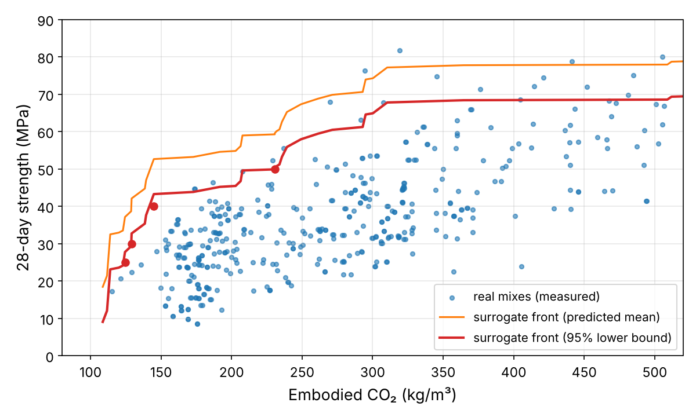</td>
<td>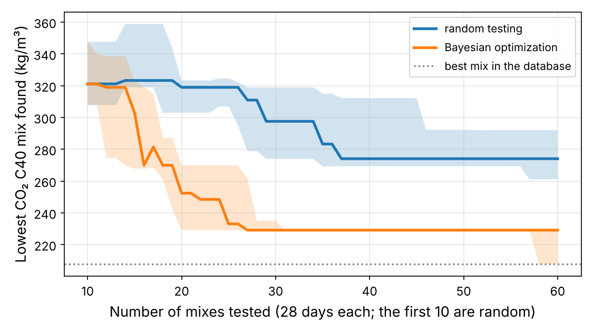</td>
</tr></table>

- **Group leakage:** random CV reports 4.5 MPa; folds grouped by mix give the honest 5.9 MPa, because each mix is tested at several ages.
- Rediscovered **Abrams' law (1918)** from the data, then compared a physics baseline with linear, random forest, gradient boosting, MLP and GP models.
- **Monotonic constraints** cost 0.2 MPa of accuracy but keep the model physically sane under optimisation; **split-conformal** lower bounds cover 95.4% of unseen mixes. Test RMSE 5.2 MPa, R² 0.90.
- Screening a million virtual mixes promises 15–30% savings: the **optimiser's curse**. Nearest-neighbour checks and a GP second opinion expose it; a trust-region search gives credible designs with **8–13% less CO₂**.
- A retrospective Bayesian-optimisation lab campaign reaches **229 kg CO₂/m³** for C40 concrete after 40 tests, against 274 kg for random testing.

## 3. Emulating a climate model

Emulators that turn emissions into warming maps in milliseconds instead of months of supercomputer time, trained on **real CMIP6 output** (ClimateBench / NorESM2).

<table><tr>
<td>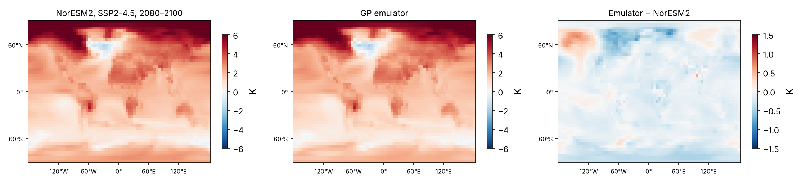</td>
<td>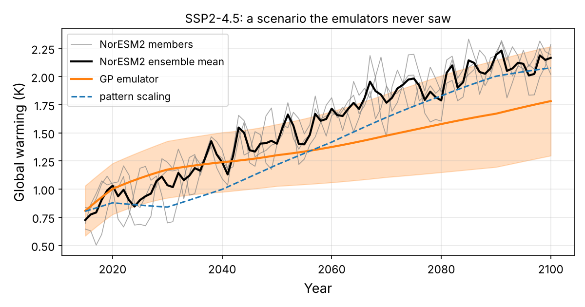</td>
</tr></table>

- Reduced 900 MB of netCDF files; compressed aerosol emission maps into **EOFs (PCA)**.
- Measured the **noise floor** from internal variability (0.32 K on maps, 0.08 K global): the error no emulator can beat.
- Compared pattern scaling, ridge, random forest, MLP and a **multi-output GP over 3,456 outputs** (shared kernel, PCA outputs; scikit-learn's gradient would have needed 219 GB).
- **Leave-one-scenario-out CV:** the GP interpolates best but fails to extrapolate to SSP5-8.5, where linear models hold up.
- On held-out SSP2-4.5 the best emulators come within **0.05–0.07 K** of the noise floor. Used for net-zero scenarios and carbon budgets (each decade of delay adds about 0.04 K of peak warming).

## 4. Physics-informed neural networks for soil temperature

A PINN in PyTorch on **real hourly soil temperatures** at five depths from a NOAA climate station in Colorado.

<table><tr>
<td>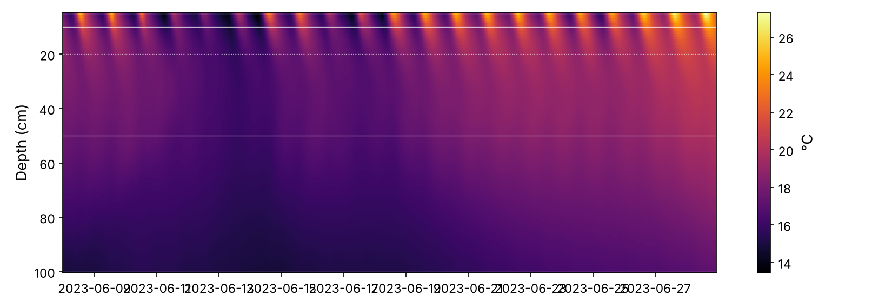</td>
<td>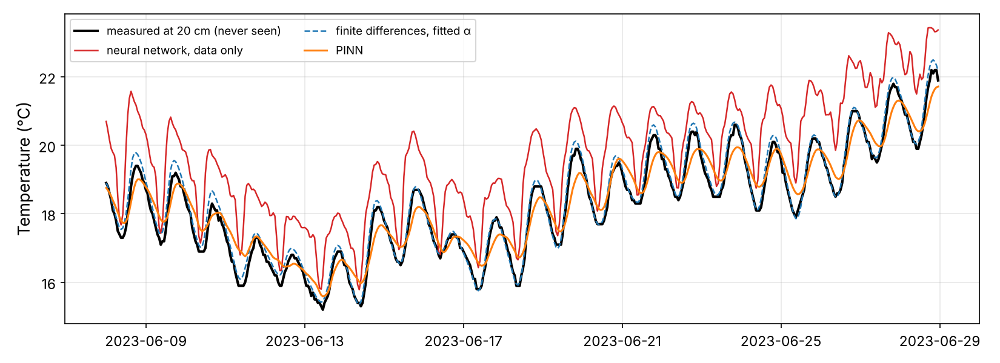</td>
</tr></table>

- Ångström's daily-wave method, layer by layer, shows the soil is layered: diffusivity rises about **9×** below the dry topsoil.
- Diagnosed why a naive PINN fails (physics residual ~100× too large in normalised time) and fixed it by **nondimensionalising the loss**; added Fourier features against spectral bias, swept the physics weight λ and ensembled seeds.
- Held-out sensor at 20 cm: finite-difference solver **0.20 °C**, PINN **0.46 °C**, data-only network **1.45 °C**. Physics makes the network 3× better, and the classical solver still wins on a simple 1D linear problem.
- The PINN's exact gradient gives the **ground heat flux**, which no sensor measures: up to about 45 W/m² at midday.

## 5. Fourier neural operator from scratch

Learn the whole solution operator of the viscous Burgers equation, u(x, 0) → u(x, 0.5).

<table><tr>
<td>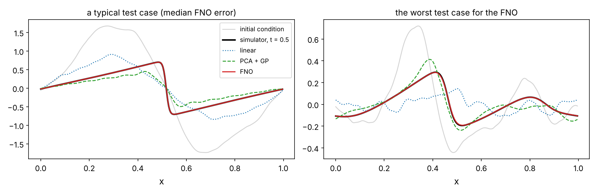</td>
<td>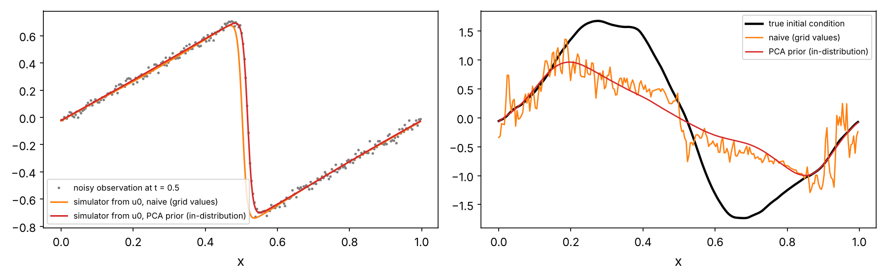</td>
</tr></table>

- A pseudo-spectral RK4 solver with 2/3 dealiasing, verified against the exact **Cole–Hopf** solution to 10⁻⁹; 1,200 simulations from Gaussian-random-field inputs.
- **FNO: 0.44%** test error. Baselines: linear 68%, PCA + GP 20.5%, MLP 20.1%. With just 100 training runs the FNO reaches 5.6%.
- **Zero-shot super-resolution:** trained at 256 points, same error from 64 to 1,024 points; about **170× faster** than the solver.
- Out-of-distribution inputs degrade it 3–6×. An **inverse problem** through the differentiable surrogate: a naive search fools it (26% true misfit); a PCA prior keeps it honest (1%).

## 6. Calibrating an epidemic model with emulators

Calibrate a stochastic S-E-I-C-R model to the **real 1978 boarding-school influenza outbreak** (763 boys).

<table><tr>
<td>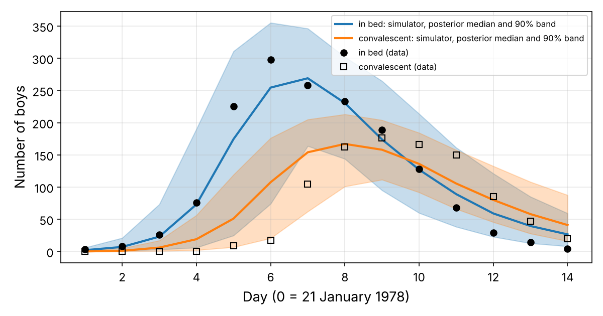</td>
<td>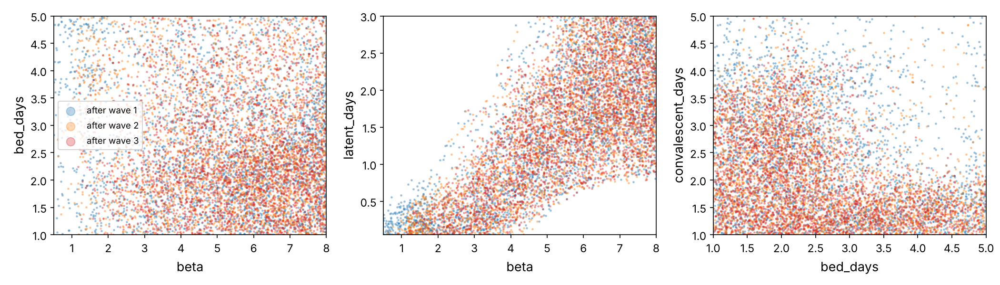</td>
</tr></table>

- Vectorised stochastic binomial-chain simulator; GP emulators of both the **mean and the stochastic variance**, validated on fresh runs.
- **History matching** in three waves cuts the parameter space to 18% of the prior box.
- The emulator-based synthetic-likelihood posterior matches 100,000-run ABC with **35× fewer runs** (2,880).
- Identifiability (time in bed ~2.1 days and convalescence ~1.5 days are sharp; R₀ is weakly identified), **model discrepancy** (homogeneous mixing infects all 763 boys; 512 were reported ill), and counterfactual interventions with uncertainty.

---

## Repository layout

Each project folder contains a Jupyter notebook that reproduces every number and figure, `images/`, `datasets/` where the project uses external data, and `animations/`: an interactive HTML tool that runs the project's final model in the browser.

## Running the projects

```bash
python3 -m pip install -U jupyter numpy scipy pandas matplotlib scikit-learn joblib xlrd xarray netCDF4 torch
jupyter notebook
```

## Data sources

Concrete Compressive Strength (I-Cheng Yeh, 1998; UCI, CC BY 4.0); ClimateBench v1.0 (Watson-Parris et al., 2022) from NorESM2-LM, CMIP6; NOAA U.S. Climate Reference Network, station Nunn 7 NNE, Colorado; influenza in a boarding school (British Medical Journal, 1978; R package `outbreaks`).
